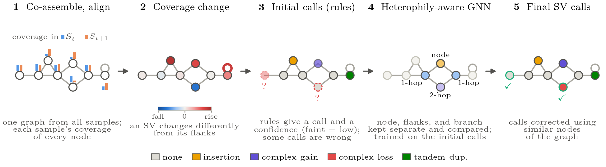

# HeteroSV

## Overview

HeteroSV is a self-supervised caller of structural variants (SVs) in long-read metagenome series. It co-assembles the samples into one graph, gives every node an initial call with simple motif rules, and trains a heterophily-aware graph neural network on these calls, on the same graph, to call every node. It needs no reference genome, no ground truth, and no thresholds tuned to the dataset. This repository contains the method, a small example, and the scripts that reproduce the results in the main body of the paper.

<p align="center"></p>

```
heterosv/         the method
run_heterosv.py   from reads to SV calls
example/          toy reads for the Quick Start
experiments/      one script per table or figure of the paper
data/             download scripts (the data themselves are not in the repository)
paper_results/    outputs of the paper's own run, for comparison
third_party/      Rhea's code
```

## Installation

Linux with [conda](https://docs.conda.io/). A GPU is optional: on the toy example, HeteroSV's calling step takes seconds on a CPU.

```bash
git clone https://github.com/aliaaz99/HeteroSV.git
cd HeteroSV
conda env create -f environment.yml
conda activate heterosv
```

`environment.yml` installs metaFlye, minigraph, minimap2, seqkit, and sra-tools, and then the Python packages of `requirements.txt` with pip. If you already have these tools, `pip install -r requirements.txt` is enough. The default PyTorch wheel on Linux uses CUDA 11.7; see [PyTorch's previous versions](https://pytorch.org/get-started/previous-versions/#v1131) for other builds. Drawing the figures also needs LaTeX and dvipng.

## Quick Start

The example is the toy dataset released with Rhea: reads of two *E. coli* variants at two time points.

**1. Get the reads.**

```bash
bash example/download.sh
```

**2. Call SVs.** co-assembly, alignment of each sample to the graph, coverage, initial calls, and ten trained networks whose majority call is the result.

```bash
python run_heterosv.py example/t0.fasta example/t1.fasta --out heterosv_out
```

**3. Read the calls.** The run prints the number of SV nodes per type: 12 to 17 of 32 to 36 nodes in our runs, because metaFlye's graph differs slightly between runs.

```bash
head heterosv_out/step0/sv_calls.tsv
```

```
node_id  sv_type       node_length  cov_t0  cov_t1  lfc     seed_agreement
1        complex gain  1134         0.0     5.1921  2.3763  1.0
6        complex gain  827          0.0     2.9938  1.582   0.9
```

`sv_calls.tsv` lists the graph nodes called as an SV, `sv_nodes.fasta` their sequences, and `all_nodes.tsv` every node. One folder `step<k>/` is written per pair of consecutive samples. Calls are per node: the two branches of a complex indel, for example, are two rows.

For your own data, give the reads in series order and name their type as metaFlye does (`--read-type nano-raw`, `nano-hq`, `pacbio-hifi`, ...). `python run_heterosv.py --help` lists the options. The defaults are the configuration of the paper's methods, `--tp 0.5 --ts 0.5`.

## Reproducing Paper Results

The data behind the paper are on Zenodo ([doi:10.5281/zenodo.23818810](https://doi.org/10.5281/zenodo.23818810)): the co-assembly graphs, read alignments, ground truth, reads, and outputs of the other callers. The scripts below reproduce the results from these data.

Each script of `experiments/` reproduces one result of the main body and writes it to `results/<name>/`. Run them from the root of the repository, in the `heterosv` environment.

| Script | Reproduces | Output in `results/` | Time, retraining |
|---|---|---|---|
| `experiments/00_fig1_overview.sh` | Figure 1 | `fig1_overview/fig1.pdf` |
| `experiments/01_table1_benchmark.sh` | Table 1 | `table1_benchmark/table1.md` |
| `experiments/02_fig2_heterophily.sh` | Figure 2 | `fig2_heterophily/fig2.pdf` |
| `experiments/03_fig3_learning_step.sh` | Figure 3 | `fig3_learning_step/fig3.pdf` |
| `experiments/04_fig4_table2_cheese.sh` | Figure 4, Table 2 | `fig4_table2_cheese/fig4.pdf`, `table2.md` |
| `experiments/05_fig5_speed.sh` | Figure 5 | `fig5_speed/fig5.pdf` |

To list the numbers stated in the text next to the paper's values:

```bash
PYTHONPATH=.:experiments/src python experiments/src/paper_numbers.py   # writes results/paper_numbers.md
```

### Running the scripts

```bash
bash data/download.sh               # Zymo from OSF, prepared data from Zenodo: 1 GB, 3 GB unpacked
bash data/download_cheese_reads.sh  # only for script 04: cheese reads from SRA, 5.9 GB
bash experiments/01_table1_benchmark.sh
```
This repeats the training, scoring, and read-support tests. `DEVICE=cpu` and `THREADS=32` set the device and the threads.


## License and Citation

If you use HeteroSV, please cite:

> Ali Azizpour, Todd J. Treangen, and Santiago Segarra. *HeteroSV: Heterophilic Graph Learning for Structural Variant Calling in Metagenomes.*

`third_party/rhea/` contains code of [Rhea](https://github.com/treangenlab/rhea) (MIT License, Kristen Curry and Todd J. Treangen), unchanged in `rhea.py` and with sparse edge counts in `rhea_sparse.py`. The other tools are installed from their own distributions, under their own licenses: [metaFlye](https://github.com/fenderglass/Flye), [minigraph](https://github.com/lh3/minigraph), [minimap2](https://github.com/lh3/minimap2), [NanoSim](https://github.com/bcgsc/NanoSim), [SURVIVOR](https://github.com/fritzsedlazeck/SURVIVOR), [MUM&Co](https://github.com/SAMtoBAM/MUMandCo), [MetaBAT 2](https://bitbucket.org/berkeleylab/metabat), [skani](https://github.com/bluenote-1577/skani), [Sniffles2](https://github.com/fritzsedlazeck/Sniffles), [geNomad](https://github.com/apcamargo/genomad), and [sourmash](https://github.com/sourmash-bio/sourmash).
